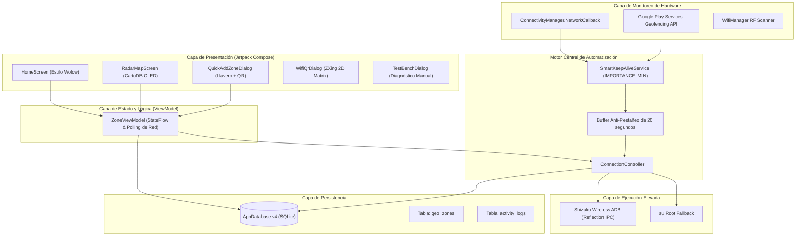
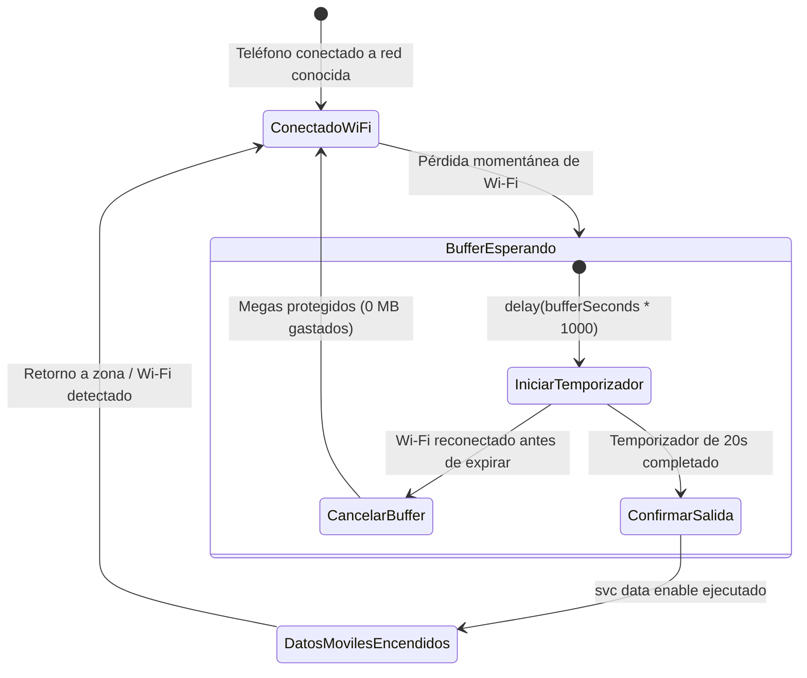

# 📐 Arquitectura Técnica del Sistema — Smart Wifi Switch

Documento de referencia técnica sobre la ingeniería de software, arquitectura de red, almacenamiento, permisos y ciclo de vida de **Smart Wifi Switch**.

---

## 1. Visión General de la Arquitectura

La aplicación está diseñada bajo el patrón de arquitectura **MVI / MVVM reactivo** en Android con **Jetpack Compose**, **Kotlin Coroutines / Flow**, y una capa de persistencia **Room**.

---

## 2. Modelo de Datos y Esquema Room (v4)

### Entidad: `GeoZone` (`geo_zones`)
Representa un perímetro geográfico protegido con sus redes Wi-Fi asociadas y credenciales de llavero:

| Campo | Tipo | Descripción |
| :--- | :--- | :--- |
| `id` | `Long` (PK, Auto) | Identificador único de la zona |
| `name` | `String` | Nombre asignado (ej. "Casa", "Trabajo", "Casa Juan") |
| `latitude` | `Double` | Coordenada GPS de latitud |
| `longitude` | `Double` | Coordenada GPS de longitud |
| `radiusMeters` | `Float` | Radio de detección de la geocerca (50m - 500m) |
| `isEnabled` | `Boolean` | Interruptor maestro de activación para esta zona |
| `wifiOnAtEntry` | `Boolean` | Encender Wi-Fi al entrar |
| `dataOffAtEntry` | `Boolean` | Apagar datos móviles al entrar (`0 megas`) |
| `wifiOffAtExit` | `Boolean` | Apagar Wi-Fi al salir (ahorro de batería) |
| `dataOnAtExit` | `Boolean` | Encender datos móviles al salir (mantener internet) |
| `lastTriggeredAt` | `Long` | Timestamp epoch de la última transición |
| `linkedWifiSsids` | `String?` | SSIDs separados por comas (ej. `"Fibra_5G,Fibra_2.4G"`) |
| `batteryMode` | `String` | `"HYBRID"` (0% batería en Wi-Fi), `"WIFI_ONLY"`, `"GEOFENCE_ONLY"` |
| `disconnectBufferSeconds` | `Int` | Segundos de tolerancia anti-caídas (15s a 30s) |
| `vibrateOnAction` | `Boolean` | Confirmación háptica imperceptible |
| `wifiPassword` | `String?` | Clave Wi-Fi almacenada en llavero seguro |
| `category` | `String` | `"HOME"`, `"WORK"`, `"FRIEND"`, `"SCHOOL"`, `"GYM"`, `"CAFE"`, `"CUSTOM"` |
| `notes` | `String?` | Recordatorios adicionales |

---

## 3. Algoritmo Anti-Pestañeo (Anti-Flapping Grace Period)

Uno de los problemas más comunes al automatizar datos móviles es el "pestañeo" de red:
1. El usuario está en su habitación o el patio y la señal Wi-Fi cae durante 3 segundos.
2. Un algoritmo ingenuo encendería los datos móviles de inmediato y consumiría megas innecesariamente.
3. El router se reinicia y durante 15 segundos no hay señal.

### Diagrama de Estados del Buffer:

---

## 4. Control Elevado de Redes (Shizuku IPC + Root)

En Android 11+ (`API 30` a `API 34`), la clase privada `TelephonyManager.setDataEnabled()` y los comandos de sistema requieren el permiso `android.permission.MODIFY_PHONE_STATE`, reservado exclusivamente para aplicaciones del sistema o firmware del fabricante.

### Implementación mediante Shizuku:
* **Mecanismo:** Reflexión dinámica sobre el método privado `Shizuku.newProcess(String[] cmd, String[] env, String dir)`.
* **UID de ejecución:** Ejecuta procesos bajo el usuario `shell` (UID 2000), el cual cuenta con autorización de depuración inalámbrica para invocar binarios del sistema:
  * `svc data disable` (apaga los datos móviles instantáneamente).
  * `svc data enable` (enciende los datos móviles).
  * `svc wifi enable` / `svc wifi disable` (gestiona el estado de la antena Wi-Fi).
* **Fallback a Root:** En dispositivos con Magisk / KernelSU, si Shizuku no está enlazado, se canalizan los comandos mediante tubería de entrada estándar a `/system/bin/su`.

---

## 5. Cartografía y Renderizado Raster Offline (CartoDB Dark Matter)

Para evitar las marcas de agua de Google Maps (*"For development purposes only"*), claves de API con vencimiento o facturación obligatoria, se implementó el motor **OSMDroid** con tiles técnicos oscuros:

* **Servidor de Mosaicos:** `https://[a,b,c].basemaps.cartocdn.com/rastertiles/dark_all/{z}/{x}/{y}.png`.
* **User-Agent Obligatorio:** Se inyecta en `SmartWifiApp.kt`:
  `SmartWifiSwitch/1.0.0 (Linux; Android ${Build.VERSION.RELEASE}; ${Build.MODEL})`.
* **Caché en Disco:** Las capas consultadas se almacenan localmente en `context.cacheDir/osmdroid/tiles`, permitiendo explorar las zonas guardadas completamente fuera de línea.
* **Escalado DPI:** `mapView.isTilesScaledToDpi = true` ajusta la densidad de píxeles a pantallas FullHD+ AMOLED (1080x2400) sin pixelación.

---

## 6. Generación de Códigos QR para Compartir Wi-Fi (ZXing)

Se implementó la especificación internacional para credenciales Wi-Fi en formato de matriz bidimensional:
`WIFI:T:WPA;S:<SSID>;P:<PASSWORD>;H:<IS_HIDDEN>;;`

* **Biblioteca:** `com.google.zxing:core:3.5.3` (librería Java pura de 500 KB, sin sobrecarga ni dependencias pesadas).
* **Renderizado:** Se genera una `BitMatrix` de 512x512 píxeles convertida en un `android.graphics.Bitmap` de alto contraste (fondo blanco, matriz negra), garantizando 100% de legibilidad para lentes gran angular de Xiaomi, Samsung y Apple.
